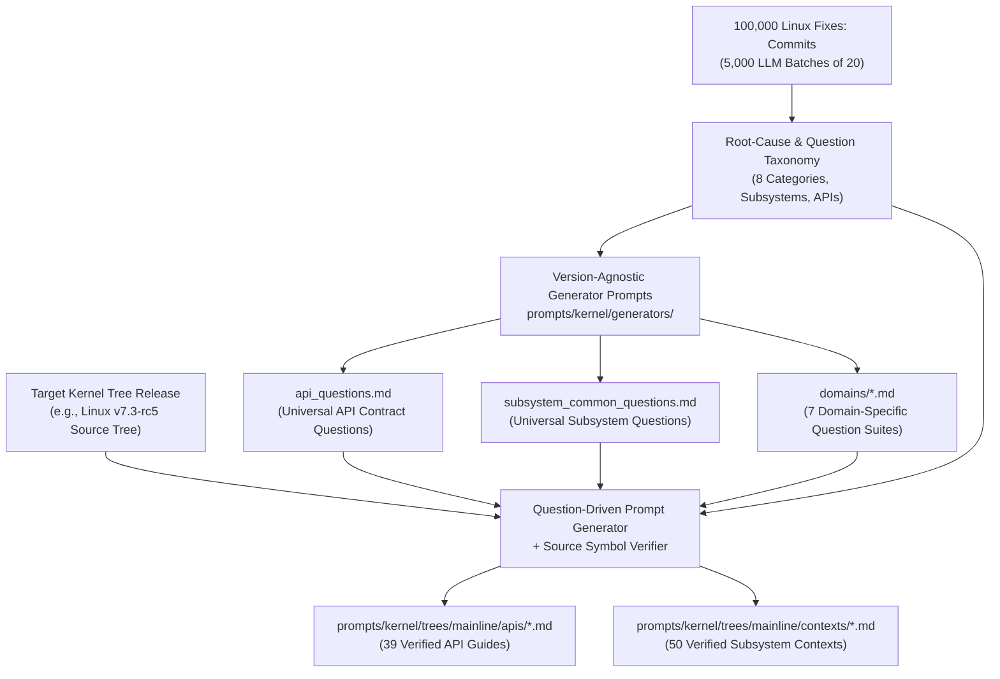

# Design: Empirical 100k `Fixes:` Analysis & Version-Agnostic Prompt Generation

## 1. Objective & Motivation

Maintaining accurate, high-signal code review prompts across multiple Linux
kernel trees (`mainline`, stable LTS releases) requires separating:
1. **Version-Agnostic Architectural & Contract Questions** (`prompts/kernel/generators/`):
   High-level, generic, actionable questions derived empirically from real
   kernel bugs that contain **no** function names, struct names, macro names,
   or version numbers.
2. **Tree-Specific Generated Code Contexts & API Guides** (`prompts/kernel/trees/<tree_id>/{contexts,apis}/`):
   Concrete, code-verified answers to those questions generated against a
   specific kernel release (such as `v7.3-rc5`).

By grounding the question suites in an LLM root-cause analysis of the last
100,000 non-merge Linux kernel commits containing `Fixes:` tags, the generator
questions systematically target the exact invariants, lifecycle rules, locking
hierarchies, and boundary checks whose violation causes real kernel bugs.

---

## 2. Empirical Analysis of 100,000 Linux Kernel `Fixes:` Commits

All 100,000 most recent non-merge commits with `Fixes:` tags up to `v7.3-rc5`
(`5a956dde5526`) were extracted with their cleaned commit descriptions and
modified file paths and analyzed in 5,000 batches of 20 commits using an LLM
root-cause classifier (`gemini-3.1-flash-lite-preview` with structured schema
output). For each commit, the LLM identified:
- The target subsystem (`subsys`) and kernel API family (`api`)
- The root-cause bug category (`cat`) and recurring bug pattern group (`group`)
- A one-sentence technical description of the fixed defect (`problem`)
- A version-agnostic, C-identifier-free preventive question (`question`)

### 2.1 Root-Cause Category Distribution (100,000 Commits)

| Root-Cause Category | Commits | Share | Top Recurring Bug Groups |
|---------------------|--------:|------:|--------------------------|
| **API Contract & Return/Context Misuse** | 18,501 | 18.5% | Error-pointer vs null sentinel mismatch, sleeping allocation in atomic context, premature registration before initialization, wrong error code propagation, unchecked fallible helper return |
| **Memory Safety, Bounds & Integer/Type Integrity** | 15,176 | 15.2% | Uninitialized variable/buffer usage, null pointer dereference, out-of-bounds array/buffer access, packet header access without linear pull, integer overflow/truncation in size math |
| **Subsystem State Machine & Invariant Violation** | 13,913 | 13.9% | Premature publication before init complete, invalid state transition ordering, stale state after dynamic reconfiguration/reset, inconsistent state flag management |
| **Error Handling, Unwind & Resource Leaks** | 13,909 | 13.9% | Unbalanced reference count on error path, error-pointer vs null check mismatch, memory/resource leak on early return, missing device-tree node put on loop break, double free on unwind |
| **Build, Kconfig & ABI/Compat** | 11,811 | 11.8% | Missing Kconfig dependency/select, 32/64-bit compat layout or alignment mismatch, missing module device table, header/export mismatch |
| **Hardware, DMA, Power & Bus Protocol** | 11,559 | 11.6% | Register bitmask/offset programming error, hardware init sequence violation, devicetree/ACPI property mismatch, DMA buffer alignment/stack-allocation violation, runtime PM/clock imbalance |
| **Concurrency & Synchronization** | 10,228 | 10.2% | Missing read-side critical section around lockless pointer dereference, uncancelled work/timer before free, sleeping in atomic context, ABBA lock ordering inversion, missing serialization lock |
| **Object Lifecycle, Teardown & Reference Counting** | 4,903 | 4.9% | Unbalanced reference count across lifecycle, uncancelled async work/timer/IRQ before kfree, premature registration, use-after-free during teardown or race, conflicting managed vs manual cleanup |

### 2.2 Top Kernel API Families Involved in `Fixes:` Commits

Across the 100,000 commits, the most frequently implicated API families are:
1. **Open Firmware / Devicetree (`of_devicetree`)**: 3,848 commits (iterator reference leaks on break/return, phandle/node refcount balance, resource lookup unwind)
2. **Kernel Locking (`locking`)**: 3,699 commits (spinlock vs mutex context violations, ABBA lock ordering, missing unlock on error paths, lockdep precondition violations)
3. **Network Device (`netdev`) & Packet Buffers (`skb`)**: 3,396 commits (headroom/linear pull assumptions, clone/shared buffer mutation, carrier/NAPI teardown ordering, netdev reference tracking)
4. **VFS Dentry & Inode (`vfs_dentry_inode`)**: 1,722 commits (inode lock nesting, dentry positive/negative transition races, mount/file reference leaks)
5. **Clock (`clk`) & Runtime PM (`pm_runtime`)**: 2,684 commits (prepare/enable vs disable/unprepare imbalance, resume-and-get error handling, suspend/resume state desync)
6. **Interrupts (`irq`), Workqueue (`workqueue`), and Timers (`timers`)**: 2,239 commits (requesting IRQ before state init, failing to synchronously cancel pending work/timers before freeing enclosing struct)
7. **Memory Allocation (`mm_alloc`) & Folios (`folio`)**: 1,662 commits (GFP flags in non-sleeping context, zero-size allocation sentinels, folio lock vs reference count ordering)
8. **Error Pointer Sentinels (`err_ptr`)**: 975 commits (checking NULL on functions returning error pointers or vice versa, passing error pointers to free/put helpers)
9. **Direct Memory Access (`dma_mapping`)**: 913 commits (DMA from stack/unaligned buffers, missing `dma_mapping_error` check, wrong direction or unmap size)
10. **Device-Managed Resources (`devm`)**: 694 commits (mixing managed allocations with manual teardown, release ordering relative to non-managed teardown)

---

## 3. Version-Agnostic Prompt Generation Architecture

### 3.1 Generator Prompt Constraints (`prompts/kernel/generators/`)

Every generator prompt file under `prompts/kernel/generators/` is strictly
validated to ensure it contains:
- **Zero C/Rust code identifiers**: No function names (`foo()`), struct names
  (`struct bar`), macro names, or `snake_case` tokens.
- **Zero file paths or kernel version numbers**: Questions are phrased in pure,
  reusable operating-systems architectural language so the exact same question
  suite can be executed against Linux `v7.3-rc5`, future mainline releases, or
  historical LTS trees (`linux-6.12.y`, `linux-6.6.y`, `linux-5.15.y`).
- **Two-level subsystem hierarchy**:
  - `subsystem_common_questions.md` asks universal questions applicable to all
    subsystems (synchronization hierarchy, object lifecycle, probe/teardown
    symmetry, async cancellation, power transitions, untrusted input bounds).
  - `domains/*.md` adds deep domain-specific questions for Filesystems/VFS,
    Memory Management, Networking, Storage/Block, Graphics/DRM/Media,
    Drivers/Buses/DMA/PM, and Arch/Virtualization/BPF/Core.

### 3.2 Iterative Generation & Verification Loop for `v7.3-rc5`

For each target API guide (`apis/*.md`) and subsystem context (`contexts/*.md`):
1. **Source Extraction**: Extract header definitions, structs, kernel-doc
   comments, and core implementation routines from the target kernel tree tag
   (`v7.3-rc5`).
2. **Empirical Bug Grounding**: Aggregate all matching `Fixes:` commits and bug
   groups from the 100k dataset for that specific subsystem or API.
3. **Question-Driven Synthesis**: Answer the generator questions against the
   `v7.3-rc5` source context and empirical bug patterns.
4. **Verification & Iterative Refinement**: Audit the draft against the
   `v7.3-rc5` source tree and baseline verified invariants to ensure no
   hallucinated symbols exist and no concrete rules or false-positive guards are
   lost.
