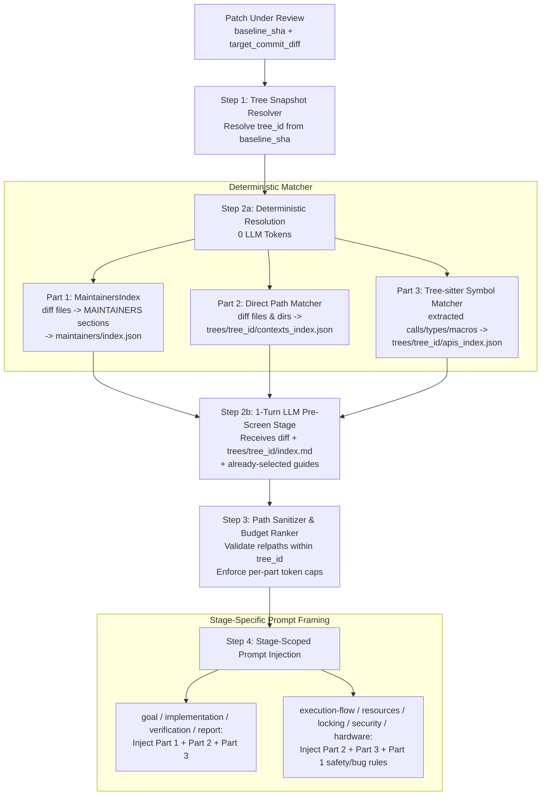
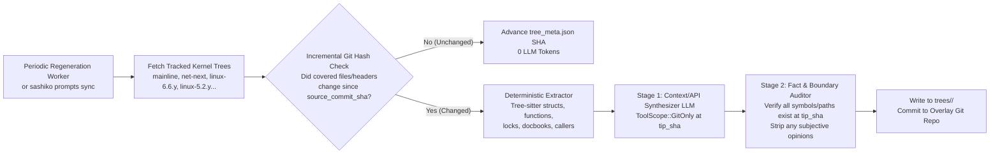

# Design: Three-Part Multi-Version Kernel Prompts, Injection, and Auto-Generation

> **Companion Design:** Continuous human feedback ingestion and maintainer
> patch-reply differential analysis are designed as a separate follow-on project
> in [`designs/DESIGN_PROMPT_FEEDBACK_PIPELINE.md`](./DESIGN_PROMPT_FEEDBACK_PIPELINE.md).

## 1. Problem Statement & Motivation

Sashiko currently loads Linux kernel review guidance from a flat collection of
manually curated markdown files under `third_party/prompts/kernel/subsystem/`
(indexed by `subsystem/subsystem.md` and selected during the `pre-screen`
stage). As Sashiko scales across the entire Linux kernel and across multiple
kernel trees, this single-layer prompt design exhibits three core architectural
limitations:

1. **Conflation of Subjective Policy, Code Architecture, and API Contracts:**
   Existing guides mix subjective maintainer preferences (e.g., variable
   declaration ordering, whether cleanups or new module parameters are welcome),
   subsystem-specific code mechanics (how a subsystem's state machine or
   locking hierarchy works), and general kernel API contracts (how `rcu_*`,
   `skb_*`, or `folio_*` helpers behave). When bug-hunting stages read
   subjective style rules, they can produce noisy style findings; conversely,
   when subjective maintainer expectations are buried inside technical guides
   or missing altogether, Sashiko misses subsystem-specific policy violations.
2. **Incomplete `MAINTAINERS` Coverage:**
   The Linux kernel `MAINTAINERS` file defines over 2,800 sections, whereas
   `third_party/prompts/kernel/subsystem/` contains ~60 files. Most subsystems
   lack dedicated maintainer guidance, and existing files do not map 1:1 to
   formal `MAINTAINERS` entries.
3. **Single-Version Assumption (Mainline vs. LTS / Stable / `-next` Drift):**
   Existing prompts implicitly assume Linus's top-of-trunk (`torvalds/linux`
   `master`). However, Sashiko regularly reviews patches targeting older LTS
   and stable trees (e.g., `linux-5.2.y`, `linux-5.10.y`, `linux-5.15.y`,
   `linux-6.1.y`, `linux-6.6.y`) as well as subsystem `-next` trees. What is
   accurate in top-of-trunk—such as `struct folio`, VMA maple trees,
   `cleanup.h` (`__free` / `guard`), `timer_delete_sync()`, or modern lockless
   helpers—is non-existent or semantically different in `5.2` or `5.10`.
   Injecting mainline code contexts or API rules into an older LTS review leads
   to hallucinated APIs and false positives.

---

## 2. Design Goals

1. **Strict Three-Part Separation of Kernel Knowledge:**
   - **Part 1 — Maintainers Notes (`maintainers/`):** Subjective, policy, style,
     and evolutionary guidance mapped directly to `MAINTAINERS` section entries
     (one `.md` file per entry or group of related entries). Strictly excludes
     descriptions of how the code currently works.
   - **Part 2 — Subsystem & File Code Contexts (`trees/<tree_id>/contexts/`):**
     Auto-generated, periodically refreshed summaries of how kernel subsystems,
     directories, and file clusters work (data structures, lock hierarchies,
     state machines, lifecycles), maintained as separate snapshots per tracked
     major kernel tree.
   - **Part 3 — Kernel API Guides (`trees/<tree_id>/apis/`):**
     Auto-generated rules, calling-context expectations, ownership conventions,
     return-value semantics, and pitfalls for commonly used kernel APIs,
     maintained per tracked major kernel tree.
2. **Hybrid Git-Backed Storage with Runtime Overlay:**
   Ship baseline prompts in the compiled bundle while reading at runtime from a
   writable, Git-backed prompt overlay repository/branch where periodic
   regenerations (and future feedback updates) are committed with full Git
   history and provenance trailers.
3. **Hybrid Deterministic + LLM `pre-screen` Injection:**
   Use zero-token deterministic matching for Part 1 (via `MaintainersIndex`),
   direct file/directory Part 2 contexts, and direct Tree-sitter symbol matches
   for Part 3, combined with a 1-turn LLM `pre-screen` pass to select broader
   cross-cutting subsystem contexts and API guides for the active `<tree_id>`.
4. **Incremental Multi-Tree Auto-Generation:**
   Periodically synchronize Part 2 contexts and Part 3 API guides across
   configured major kernel trees using zero-token Git blob/tree hash checks so
   LLM synthesis only runs when underlying kernel source files or headers
   actually change.

---

## 3. Three-Part Prompt Architecture & Storage Layout

### 3.1 Hybrid Git-Backed Directory Hierarchy

Sashiko resolves kernel prompts through a two-layer filesystem hierarchy:
1. **Runtime Overlay Repository (`[prompts].overlay_path`):** A local Git
   checkout (e.g., `$XDG_DATA_HOME/sashiko/prompts-overlay/kernel/`) tracking a
   dedicated prompt repository or branch. All auto-generated context/API
   regenerations are committed here.
2. **Compiled-In Prompt Bundle (`prompt_bundle.rs`):** The read-only fallback
   extracted to `$XDG_DATA_HOME/sashiko/prompts/<revision>/kernel/`, ensuring
   `sashiko review` works out-of-the-box in offline or unconfigured environments.

```text
kernel/
├── framing/                          # Core workflow framing & templates
│   ├── review-core.md
│   ├── severity.md
│   ├── false-positive-guide.md
│   └── inline-template.md
│
├── maintainers/                      # PART 1: Subjective Maintainers Notes
│   ├── index.json                    # Maps MAINTAINERS section titles -> file
│   ├── networking-general.md         # Covers "NETWORKING [GENERAL]", "NETWORKING DRIVERS"
│   ├── bpf.md                        # Covers "BPF [GENERAL]", "BPF [NETWORKING]", ...
│   ├── mm.md                         # Covers "MEMORY MANAGEMENT", "SLAB ALLOCATOR", ...
│   ├── drm-core.md                   # Covers "DRM DRIVERS", ...
│   └── ...
│
└── trees/                            # Multi-tree snapshots for Parts 2 & 3
    ├── mainline/                     # Linus's tree (torvalds/linux master)
    │   ├── tree_meta.json            # Version (e.g. 6.14), commit SHA, timestamp
    │   ├── index.md                  # Compact pre-screen index for mainline
    │   ├── contexts_index.json       # Path glob trigger map -> contexts/*.md
    │   ├── apis_index.json           # Symbol/macro trigger map -> apis/*.md
    │   ├── contexts/                 # PART 2: Subsystem/File Code Contexts
    │   │   ├── net/core/skbuff.md
    │   │   ├── net/ipv4/route.md
    │   │   ├── mm/filemap.md
    │   │   ├── mm/vma.md
    │   │   ├── fs/btrfs/transactions.md
    │   │   └── ...
    │   └── apis/                     # PART 3: Kernel API Guides
    │       ├── skb-buffer.md
    │       ├── rcu.md
    │       ├── folio.md
    │       ├── cleanup-guards.md
    │       ├── timers.md
    │       └── ...
    │
    ├── net-next/                     # Tracked subsystem -next snapshot
    │   ├── tree_meta.json
    │   ├── index.md
    │   ├── contexts_index.json
    │   ├── apis_index.json
    │   ├── contexts/...
    │   └── apis/...
    │
    ├── linux-6.6.y/                  # Tracked LTS snapshot (6.6.y)
    │   ├── tree_meta.json
    │   ├── index.md
    │   ├── contexts_index.json
    │   ├── apis_index.json
    │   ├── contexts/...
    │   └── apis/...
    │
    └── linux-5.2.y/                  # Tracked older LTS/stable snapshot (5.2.y)
        ├── tree_meta.json
        ├── index.md
        ├── contexts_index.json
        ├── apis_index.json
        ├── contexts/...              # Uses struct page, mmap_sem, rb_tree VMAs
        └── apis/...                  # Pre-folio, pre-cleanup.h API contracts
```

---

### 3.2 Part 1: Maintainers Notes (`kernel/maintainers/*.md`)

Each file in `kernel/maintainers/` represents the subjective expectations of
the human maintainers for one or several related sections in `MAINTAINERS`.

#### Frontmatter & `MAINTAINERS` Mapping
```markdown
---
kind: maintainer_notes
sections:
  - "NETWORKING [GENERAL]"
  - "NETWORKING DRIVERS"
  - "NETWORKING [IPV4]"
  - "NETWORKING [IPV6]"
---

# Networking Maintainers Notes

## Evolution & Architectural Direction
- New driver-specific configuration parameters must use `devlink` or `ethtool`
  netlink interfaces; do not introduce new module parameters (`module_param`) or
  private `ioctl` commands.
- Prefer converting legacy `netif_napi_add()` callers to `netif_napi_add_weight()`
  only when touching the driver's NAPI initialization logic; do not send
  tree-wide mechanical conversion series.

## Welcome vs. Unwelcome Changes
- Standalone checkpatch, spelling, or whitespace-only patches on existing
  drivers are not accepted outside `staging/`.
- Fixes targeting the `net` tree must include a `Fixes:` tag and must not mix
  refactoring with bug fixes; cleanups and new features must target `net-next`.

## Coding Style & Conventions
- Local variable declarations at the top of functions must follow Reverse
  Christmas Tree (longest line to shortest line) ordering.
- Never use `BUG()` or `BUG_ON()` in networking paths; use `WARN_ON_ONCE()` and
  recover or drop the packet gracefully.
```

#### Strict Content Invariants for Part 1
- **Allowed:**
  1. Subsystem evolution goals (deprecated patterns vs. preferred replacements).
  2. Patch acceptance policy (what changes are welcome or rejected, tree routing
     between `-fixes` and `-next`, `Fixes:` tag rules, selftest requirements).
  3. Subsystem-specific coding style and formatting conventions (e.g., Reverse
     Christmas Tree variable ordering, comment styles, commit subject prefixes).
  4. Severity / error-handling philosophy (e.g., "never panic on hardware
     firmware timeouts; reset the ring and return `-EIO`").
- **Forbidden (Enforced by Automated Validator):**
  1. Explanations of how existing functions, structs, or state machines work in
     the code (belongs in Part 2).
  2. Function signatures, struct field tables, or general kernel API rules
     derivable from source headers (belongs in Part 3).

---

### 3.3 Part 2: Subsystem / File-Specific Code Contexts (`trees/<tree_id>/contexts/`)

Part 2 files are **100% objective**, auto-generated technical summaries of how a
specific subsystem, directory, or file cluster operates in `<tree_id>`.

#### Frontmatter & Metadata
```markdown
---
kind: code_context
tree_id: "linux-5.2.y"
kernel_version: "5.2"
source_commit_sha: "0ecfebd2b52404ae9de54a878c872bb93363adeb"
covered_paths:
  - "mm/mmap.c"
  - "mm/memory.c"
  - "include/linux/mm_types.h"
content_tree_hash: "8f3a1c9e4b2d..."
generated_at: "2026-10-12T00:00:00Z"
---

# Memory Management: VMA Layout and Locking (Linux 5.2)

## Data Structures & Hierarchy
- In Linux 5.2, `struct mm_struct` tracks virtual memory areas (`struct vm_area_struct`)
  via a doubly linked list (`mm->mmap`) and a red-black tree (`mm->mm_rb`), cache-hinted
  by `mm->mmap_cache`. (Note: `maple_tree` and per-VMA locks do not exist in 5.2).

## Locking & Synchronization Invariants
- All VMA tree traversals and modifications are serialized by `mm->mmap_sem`
  (`struct rw_semaphore`):
  - Read-side access (`find_vma`, page fault handling): `down_read(&mm->mmap_sem)`.
  - Write-side mutations (`mmap_region`, `do_munmap`, `split_vma`, `vma_merge`):
    `down_write(&mm->mmap_sem)`.
- Lock ordering: `i_mmap_rwsem` and `anon_vma->rwsem` nest *inside* `mm->mmap_sem`.

## Lifecycle & Invariants
- `find_vma(mm, addr)` returns the first VMA with `vma->vm_end > addr`, which may
  have `vma->vm_start > addr` (a gap). Callers must check `addr >= vma->vm_start`
  unless gap-spanning is intended.
```

Compare this with `trees/mainline/contexts/mm/vma.md`, which documents
`mm->mm_mt` (`struct maple_tree`), `mmap_read_lock(mm)` / `mmap_write_lock(mm)`,
and per-VMA lock (`vma_start_write(vma)`). Because each tracked tree has its own
snapshot directory, a 5.2 backport review receives `trees/linux-5.2.y/contexts/mm/vma.md`
and never hallucinates `maple_tree` or `mmap_read_lock` on 5.2.

---

### 3.4 Part 3: Kernel API Guides (`trees/<tree_id>/apis/`)

Part 3 files capture rules, invariants, calling contexts, ownership transfers,
and subtle pitfalls for kernel APIs as they exist in `<tree_id>`.

#### Frontmatter & Symbol Trigger Metadata
```markdown
---
kind: api_guide
tree_id: "mainline"
kernel_version: "6.14"
source_commit_sha: "a1b2c3d4e5f6..."
defining_files:
  - "include/linux/rcupdate.h"
  - "include/linux/rculist.h"
  - "kernel/rcu/tree.c"
header_blob_hashes:
  "include/linux/rcupdate.h": "4c91e2..."
  "include/linux/rculist.h": "91a0b3..."
symbols:
  exact:
    - "rcu_read_lock"
    - "rcu_read_unlock"
    - "rcu_dereference"
    - "rcu_assign_pointer"
    - "synchronize_rcu"
    - "call_rcu"
    - "kfree_rcu"
    - "kfree_rcu_mightsleep"
    - "kvfree_rcu"
  prefixes:
    - "rcu_"
    - "srcu_"
    - "list_for_each_entry_rcu"
    - "hlist_del_rcu"
---

# RCU API Rules and Contracts (Mainline)

## Calling Context & Preemption Rules
- `rcu_read_lock()` / `rcu_read_unlock()`: Delimits classic RCU read-side critical
  sections. Blocking or sleeping inside is forbidden.
- `kfree_rcu(ptr, rcu_head_field)` vs `kfree_rcu_mightsleep(ptr)`:
  - Two-argument `kfree_rcu(ptr, rhf)` is safe from atomic and IRQ contexts,
    including while holding a `raw_spinlock_t` (invokes `kvfree_call_rcu()`).
  - Single-argument `kfree_rcu_mightsleep(ptr)` may sleep to allocate memory if
    the internal page cache is empty and MUST NOT be called from atomic context.
...
```

---

## 4. Prompt Selection and Injection Mechanism



### 4.1 Step 1: Resolving `<tree_id>` for a Review (`TreeSnapshotResolver`)

Before running `pre-screen`, `Worker::run` (`src/worker/prompts.rs`) resolves the
active `tree_id` for `LinuxPatchReviewState`:

1. **Explicit Remote/Branch Match:** If `patchset.baseline` resolved to a known
   tracked branch (e.g., `net-next/master` $\rightarrow$ `net-next`,
   `stable/linux-6.6.y` $\rightarrow$ `linux-6.6.y`), select that `<tree_id>` if
   `trees/<tree_id>/` exists.
2. **Baseline `Makefile` Version Extraction:** Otherwise, inspect
   `<baseline_sha>:Makefile` (via `git show <baseline_sha>:Makefile`) and parse
   `VERSION` and `PATCHLEVEL` (e.g., `VERSION = 5`, `PATCHLEVEL = 2` $\rightarrow$
   `5.2`).
   - If `trees/linux-<VERSION>.<PATCHLEVEL>.y/` exists, select it.
   - If `<VERSION>.<PATCHLEVEL>` matches `trees/mainline/tree_meta.json`, select
     `mainline`.
   - **Nearest-Older-Ancestor Fallback:** If no exact snapshot exists for
     `X.Y` (for example, reviewing a patch on `5.3` when snapshots exist for
     `linux-5.2.y`, `linux-5.4.y`, and `mainline`), select the snapshot with the
     highest version $\le X.Y$ (`linux-5.2.y`), and emit a `<tree_version_note>`
     warning the model that the context snapshot is from `5.2` while the target
     baseline is `5.3`. Never fall forward to a much newer tree (`mainline`)
     for an old baseline unless no older snapshot exists.

### 4.2 Step 2: Hybrid Deterministic + LLM `pre-screen` Selection

Selection combines deterministic code analysis with a 1-turn LLM `pre-screen`:

1. **Deterministic Part 1 Selection (`MaintainersIndex`):**
   - Extract modified file paths via `baseline::extract_files_from_diff`.
   - Call `MaintainersIndex::match_file(path)` (`src/maintainers.rs`), which
     returns matched `MAINTAINERS` section names ordered by pattern specificity
     (`depth` descending).
   - Look up each matched section in `kernel/maintainers/index.json` to resolve
     `maintainers/<slug>.md`, preserving specificity order.
2. **Deterministic Part 2 Selection (File & Directory Contexts):**
   - Match modified file paths against the `covered_paths` globs compiled in
     `trees/<tree_id>/contexts_index.json`.
   - Exact file matches rank above directory prefix matches.
3. **Deterministic Part 3 Selection (Tree-sitter API Extraction):**
   - During `prefetch_context` (`src/worker/prefetch.rs`), Tree-sitter already
     parses modified `.c` and `.h` files to extract `called_functions`,
     `extract_type_names`, and macro invocations in modified ranges.
   - Match these extracted identifiers against `symbols.exact` and
     `symbols.prefixes` in `trees/<tree_id>/apis_index.json` to deterministically
     select Part 3 API guides.
4. **1-Turn LLM `pre-screen` Stage (`prescreen_stage`):**
   - The `pre-screen` stage receives:
     - The compact `trees/<tree_id>/index.md` catalog of available Part 2
       subsystem contexts and Part 3 API guides for `<tree_id>`.
     - The list of guides already selected deterministically (so it does not
       need to re-select them).
     - The patch diff (`{{target_commit_diff}}`).
   - It returns `additional_contexts: Vec<String>` and `additional_apis: Vec<String>`
     for any broader subsystem context or indirectly affected API contract (for
     instance, when a patch modifies a struct initializer or vtable callback
     whose registration macro is outside the diff hunk).
   - Every returned filename is validated through `sanitize_tree_prompt_relpath`
     (rejecting `..`, `\`, leading `/`, or any path outside
     `trees/<tree_id>/contexts/` and `trees/<tree_id>/apis/`).

### 4.3 Step 3: Stage-Scoped Injection & Framing

`LinuxPatchReviewState` stores the resolved prompt paths partitioned by part:

```rust
pub struct ResolvedKernelPrompts {
    pub tree_id: String,
    pub kernel_version: String,
    /// Part 1: paths relative to kernel/maintainers/
    pub maintainer_notes: Vec<PathBuf>,
    /// Part 2: paths relative to kernel/trees/<tree_id>/contexts/
    pub code_contexts: Vec<PathBuf>,
    /// Part 3: paths relative to kernel/trees/<tree_id>/apis/
    pub api_guides: Vec<PathBuf>,
    /// Overflow guides available via read_prompt tool
    pub overflow_catalog: String,
}
```

In `linux_system_prompt`, the three parts are rendered into distinct XML blocks
with explicit epistemic instructions:

```xml
<maintainer_notes>
The following documents contain subjective maintainer expectations, subsystem
evolution directions, and coding conventions for the MAINTAINERS sections
touched by this patch.
IMPORTANT: Use these notes to evaluate architectural direction, unwelcome change
patterns, and subsystem conventions. NEVER use maintainer notes to excuse or
dismiss a concrete memory corruption, leak, race condition, or crash.
@includes_maintainer_notes
</maintainer_notes>

<code_context tree="{{tree_id}}" kernel_version="{{kernel_version}}">
The following auto-generated documents describe how the affected kernel
subsystems and files work in tree '{{tree_id}}' (Linux {{kernel_version}}).
@includes_code_contexts
</code_context>

<kernel_api_rules tree="{{tree_id}}" kernel_version="{{kernel_version}}">
The following documents specify calling-context rules, ownership lifecycles,
return-value contracts, and known pitfalls for kernel APIs used in this patch
in tree '{{tree_id}}' (Linux {{kernel_version}}).
@includes_api_guides
</kernel_api_rules>
```

#### Stage Scoping Rules
- **`goal`, `implementation`, `verification`, `post-verification`, `report`:**
  Receive all three blocks (`<maintainer_notes>`, `<code_context>`,
  `<kernel_api_rules>`).
- **`execution-flow`, `resources`, `locking`, `security`, `hardware`:**
  Receive `<code_context>` and `<kernel_api_rules>` in full. To prevent pure
  static-analysis stages from emitting subjective style nits (like variable
  sorting order) as code defects, stylistic sections in `<maintainer_notes>` are
  omitted or restricted to bug/safety-relevant rules during these stages.
- **Token Budget & `read_prompt` Tool Integration:**
  - Inline injection is capped per part (e.g., 24 KB for Part 1, 48 KB for
    Part 2, 48 KB for Part 3, ordered by specificity).
  - Any matched guide exceeding the inline cap is listed under
    `<additional_available_guides>` with its relative path so stages with tools
    (`ToolScope::All`) can load it on demand via `read_prompt`.
  - `SashikoToolContext` (`src/toolbox/mod.rs`) carries `active_tree_id: Option<String>`
    so `read_prompt("contexts/mm/vma.md")` or `read_prompt("apis/rcu.md")`
    transparently resolves against `trees/<tree_id>/` while confining all reads
    via `validate_path`.

---

## 5. Periodic Auto-Generation & Multi-Tree Regeneration (Parts 2 & 3)



### 5.1 Configured Tracked Trees (`[prompts.trees]` in `Settings.toml`)

Operators configure the list of major kernel trees for which Sashiko maintains
Part 2 and Part 3 snapshots:

```toml
[prompts]
overlay_path = "sashiko-prompts-overlay"
sync_interval_seconds = 86400 # Daily incremental regeneration check

[[prompts.trees]]
id = "mainline"
remote = "origin"
branch = "master"

[[prompts.trees]]
id = "net-next"
remote = "net-next"
branch = "main"

[[prompts.trees]]
id = "linux-6.12.y"
remote = "stable"
branch = "linux-6.12.y"

[[prompts.trees]]
id = "linux-6.6.y"
remote = "stable"
branch = "linux-6.6.y"

[[prompts.trees]]
id = "linux-5.15.y"
remote = "stable"
branch = "linux-5.15.y"

[[prompts.trees]]
id = "linux-5.2.y"
remote = "stable"
branch = "linux-5.2.y"
```

### 5.2 Incremental Zero-Token Staleness Detection

Regenerating thousands of subsystem contexts and API guides across 6+ trees from
scratch on every sweep would be prohibitively expensive. Instead, regeneration
is strictly incremental:

1. **Git Blob/Tree Hash Comparison:**
   - Every Part 2 context file records `covered_paths` and `content_tree_hash`
     (the SHA-256 of the sorted `git ls-tree <sha> -- <covered_paths>` output).
   - Every Part 3 API guide records `defining_files` and `header_blob_hashes`.
   - On a periodic sweep at `<new_tip_sha>`, Sashiko runs a single
     `git ls-tree -r <new_tip_sha>` per tree and computes the current hashes in
     memory.
   - If a context or API guide's underlying kernel files have identical blob
     hashes (or if only trivial comments/unrelated lines changed, verified via a
     significance threshold on `git diff`), no LLM call is made.
2. **Cross-Tree Content Reuse on Bootstrap:**
   - When bootstrapping a new stable tree (e.g., `linux-6.12.y`) from
     `mainline`, any context or API guide whose `content_tree_hash` in
     `linux-6.12.y` matches `mainline` is copied directly from `mainline` with
     updated frontmatter (`tree_id: "linux-6.12.y"`), spending **0 LLM tokens**
     on subsystems that have not diverged between the two trees.

### 5.3 Two-Stage Generation & Fact-Verification Workflow

When a subsystem cluster or API header has changed (or is being generated for
the first time):

1. **Stage 1 — `ContextSynthesisStage` / `ApiSynthesisStage` (`ToolScope::GitOnly`):**
   - Pre-populates a structural skeleton using Tree-sitter: exported functions,
     core structs, lock fields (`spinlock_t`, `mutex`, `rw_semaphore`,
     `rcu_head`), and kernel-doc comments at `<tip_sha>`.
   - The LLM explores callers and implementations at `revision = <tip_sha>` and
     produces the structured Markdown document.
2. **Stage 2 — `ContextFactAuditStage` (Deterministic + LLM Validator):**
   - **Deterministic Symbol & Path Verifier:** Parses all backtick-quoted
     identifiers and file paths in the generated Markdown and verifies via
     `git grep` / `git ls-tree` at `<tip_sha>` that every referenced file and
     symbol actually exists in `<tree_id>` at `<tip_sha>`. If the model cited a
     symbol from its training data that does not exist in `linux-5.2.y` (e.g.,
     `folio_get`), validation fails with an actionable error naming the
     non-existent symbol so the stage retries.
   - **Boundary Validator:** Rejects any Part 2/3 draft containing subjective
     style directives (e.g., variable ordering, patch splitting rules).

---

## 6. Migration Strategy from Existing `third_party/prompts/kernel/`

To transition smoothly without regressing review quality on existing benchmarks:

1. **Automated Decomposition Script (`sashiko prompts migrate-v2`):**
   - Splits each of the existing ~60 files in `third_party/prompts/kernel/subsystem/*.md`
     into the three new categories:
     - Subjective rules (and `subjective-review.md`) $\rightarrow$ `prompts/kernel/maintainers/<slug>.md`,
       linked to their corresponding `MAINTAINERS` section titles in
       `prompts/kernel/maintainers/index.json`.
     - Subsystem code mechanics $\rightarrow$ `prompts/kernel/trees/mainline/contexts/<subsystem>.md`
       with populated `covered_paths` in `contexts_index.json`.
     - Reusable API contracts (`rcu.md`, `cleanup.md`, `timers.md`, `locking.md`,
       `workqueue.md`, `skb` rules, `folio` rules, etc.) $\rightarrow$
       `prompts/kernel/trees/mainline/apis/<api>.md` with populated `symbols`
       triggers in `apis_index.json`.
2. **Initial Multi-Tree Seeding:**
   - Run the incremental generator across the primary LTS baselines (`linux-6.12.y`,
     `linux-6.6.y`, `linux-6.1.y`, `linux-5.15.y`, `linux-5.10.y`, `linux-5.4.y`)
     to fork and regenerate only the contexts and APIs whose underlying kernel
     headers/files differ from `mainline`.
3. **Benchmark Validation:**
   - Verify on `benchmark_tiny.json` (and with human authorization on larger
     suites) that the 3-part prompt injection matches or improves recall and
     precision while eliminating anachronistic false positives on stable/LTS
     patches.

---

## 7. Step-by-Step Implementation Plan

1. **Commit 1 — Design Document:**
   - Add `designs/DESIGN_KERNEL_PROMPTS_V2.md`.
2. **Commit 2 — `MaintainersIndex` Role Granularity (`M:` vs `R:`):**
   - Extend `MaintainerSection` in `src/maintainers.rs` to distinguish
     `MaintainerRole::Maintainer` (`M:`) and `MaintainerRole::Reviewer` (`R:`)
     and expose `role_for_address_in_section(&self, email: &str, section: &str)`
     while keeping all existing `subsystems_for_address` and access-control
     APIs unchanged.
3. **Commit 3 — Overlay Prompt Bundle & Multi-Tree Resolver (`src/prompt_bundle.rs`, `src/tree_prompts.rs`):**
   - Implement two-layer prompt resolution (writable Git overlay + compiled-in
     bundle fallback) and `TreeSnapshotResolver` (mapping `baseline_sha` and
     `<baseline_sha>:Makefile` `VERSION.PATCHLEVEL` to `trees/<tree_id>/` with
     nearest-older-ancestor fallback).
4. **Commit 4 — Hybrid Deterministic + `pre-screen` Selection & Stage-Scoped Injection:**
   - Implement deterministic Part 1 (`MaintainersIndex` $\rightarrow$
     `maintainers/index.json`), Part 2 (`covered_paths` $\rightarrow$
     `contexts_index.json`), and Part 3 (Tree-sitter extracted symbols
     $\rightarrow$ `apis_index.json`) matching.
   - Update `prescreen_stage`, `linux_system_prompt`, and `ReadPromptTool` in
     `src/workflows/linux_patch_review.rs` and `src/toolbox/read_prompt.rs` to
     inject `<maintainer_notes>`, `<code_context>`, and `<kernel_api_rules>`
     with path sanitization and per-part token budgets.
5. **Commit 5 — Incremental Multi-Tree Context & API Generator Worker:**
   - Implement `ContextGeneratorWorker` and `sashiko prompts sync` with
     `git ls-tree` hash comparison, `ContextSynthesisStage`,
     `ApiSynthesisStage`, and deterministic symbol/path existence auditing.
6. **Commit 6 — Prompt Decomposition & Initial Mainline Migration:**
   - Decompose existing `third_party/prompts/kernel/subsystem/*.md` into
     `maintainers/`, `trees/mainline/contexts/`, and `trees/mainline/apis/`
     along with `index.json`, `contexts_index.json`, and `apis_index.json`.
